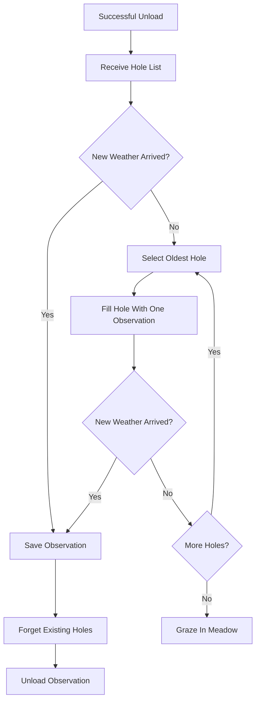
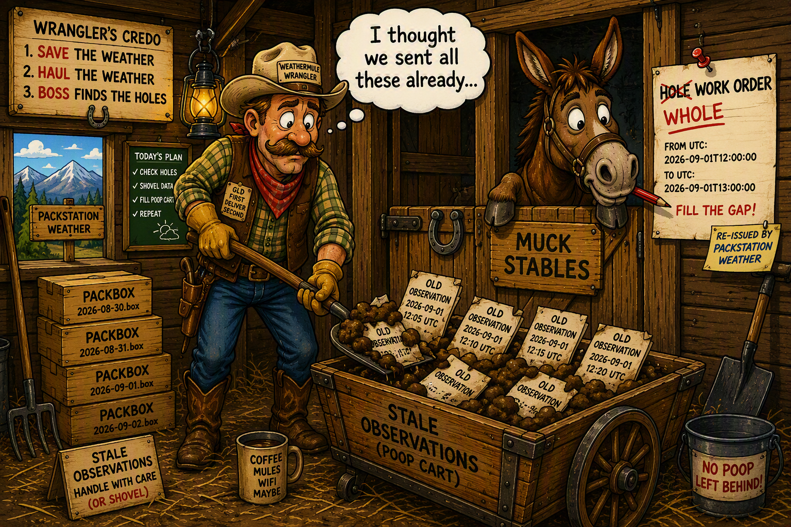

## Hole Processing

Hole processing is background work.

The mule only works holes when there is no fresh weather waiting to be hauled.

**Fresh weather always wins.**

After a successful unload, PackStationWeather may return a list of holes. These holes become the mule's current work orders.



WeatherMule never attempts to completely process a hole before checking for fresh weather.

It fills a single observation.

Then it looks up.

If new weather has arrived, the mule drops the shovel, forgets its current holes, and returns to hauling cargo.

If no new weather has arrived, the mule selects the oldest remaining hole and fills another observation.

Eventually one of three things happens:

- New weather arrives.
- The hole is completed or removed.
- There are no holes left to process.

The first outcome is the most important.

The weather station creates new cargo every few minutes. The mule must always be ready to stop maintenance work and return to hauling weather.

That is why hole processing feels less like synchronization and more like mucking stalls.

The work is useful.

The work is necessary.

But the instant new cargo arrives, everyone puts down the shovel and gets back to moving weather.



### How the Mule Fills a Hole

_Implementation:_

- [_HoleRoutines.h_](../../HoleRoutines.h)
- [_Hole.h_](../../Hole.h)
- [_StorageRoutines.h_](../../StorageRoutines.h)

At first glance, a hole appears to describe missing weather.

But a hole is more than a beginning and ending time. It is the mule's complete work order for recovering a gap.

A hole contains:

```text
FromUtc         = "2026-09-01T12:00:00Z"   (12:00)
ToUtc           = "2026-09-01T13:00:00Z"   (13:00)

FromDateRaw     = "2026-09-01+12:00:00"    (12:00)
ToDateRaw       = "2026-09-01+13:00:00"    (13:00)

ByteOffset      = 0
PartiallyFilled = false
```

Each property has a specific purpose.

- `FromUtc` is the normalized UTC string identifying the known observation at the current beginning of the hole.
- `ToUtc` is the normalized UTC string identifying the known observation at the far side of the hole.
- `FromDateRaw` is the original weather-station `dateutc` string for the observation identified by `FromUtc`.
- `ToDateRaw` is the original weather-station `dateutc` string for the observation identified by `ToUtc`.
- `ByteOffset` is a bookmark into a Packbox that helps the mule return to the current starting observation.
- `PartiallyFilled` records whether the mule has successfully recovered at least one observation from inside the hole.

The timestamps deserve special attention.

The Pack Station describes the hole using normalized UTC strings:

```text
FromUtc = "2026-09-01T12:00:00Z"
ToUtc   = "2026-09-01T13:00:00Z"
```

But those are not the strings stored in the original weather observations.

WeatherMule preserves each observation exactly as it arrived from the weather station. Inside a Packbox, the same boundary observations contain:

```text
dateutc=2026-09-01+12:00:00
dateutc=2026-09-01+13:00:00
```

Those values become:

```text
FromDateRaw = "2026-09-01+12:00:00"
ToDateRaw   = "2026-09-01+13:00:00"
```

The values represent the same two moments:

```text
"2026-09-01T12:00:00Z"  <->  "2026-09-01+12:00:00"   (12:00)

"2026-09-01T13:00:00Z"  <->  "2026-09-01+13:00:00"   (13:00)
```

WeatherMule does not convert these values into DateTime objects. On the Arduino, they remain strings.

That distinction matters because hole recovery eventually comes down to finding and comparing the original dateutc strings stored in the Packboxes.

The normalized UTC strings describe where the work order stands.

The raw strings tell the mule what to look for in its cargo.  

The normalized and raw values describe the same boundary observations in two different string representations.

The important detail is that neither boundary observation is missing.

PackStationWeather already possesses the observation at `FromUtc`.

PackStationWeather already possesses the observation at `ToUtc`.

What may be missing is everything between them.

This makes recovery much simpler than it first appears.

The mule does not need to calculate where recovery should begin. It starts from a known observation and works forward toward another known observation.

### Finding the Starting Point

The mule opens the appropriate packbox and searches for the observation identified by `FromDateRaw`.

On the first pass, this may require scanning the packbox.

Once recovery begins, the mule also maintains a `ByteOffset`. The byte offset is an internal bookmark that allows the mule to return near the current observation instead of scanning the packbox from the beginning again.

The bookmark is only an optimization. The mule still validates what it finds against the raw timestamp before trusting it.


### Recovering an Observation

After locating the observation identified by `FromDateRaw`, the mule advances to the next observation in the packbox.

That next observation becomes the recovery candidate.

If the candidate's `dateutc` does not match `ToDateRaw`, the observation falls inside the hole and is sent to PackStationWeather.

```http
POST /api/unload/hole/fill
```

After PackStationWeather accepts the observation, the hole advances.

For example, the original hole may be:

```text
FromUtc = 2026-09-01T12:00:00Z
ToUtc   = 2026-09-01T13:00:00Z
FromDateRaw = 2026-09-01+12:00:00
ToDateRaw   = 2026-09-01+13:00:00
ByteOffset = 0
PartiallyFilled = false
```

The mule finds the `12:00` observation and advances to:

```text
12:05
```

The `12:05` observation is sent to PackStationWeather, and the hole becomes:

```text
FromUtc         = 2026-09-01T12:05:00Z    (12:05)
ToUtc           = 2026-09-01T13:00:00Z    (13:00)
FromDateRaw     = 2026-09-01+12:05:00     (12:05)
ToDateRaw       = 2026-09-01+13:00:00     (13:00)
ByteOffset      = 1234
PartiallyFilled = true
```

The byte offset now identifies the `12:05` observation in the packbox.

The next time the mule processes the hole, it returns to the `12:05` observation, verifies that the timestamp matches `FromDateRaw`, and advances to the following observation.

If the following observation is `12:10`, the mule sends `12:10` to PackStationWeather and advances the hole again:

```text
FromUtc         = 2026-09-01T12:10:00Z    (12:10)
ToUtc           = 2026-09-01T13:00:00Z    (13:00)
FromDateRaw     = 2026-09-01+12:10:00     (12:10)
ToDateRaw       = 2026-09-01+13:00:00     (13:00)
ByteOffset      = 2345
PartiallyFilled = true
```

In effect, the hole slowly shrinks as the mule walks through the packbox one observation at a time.

### Reaching the Far Side of the Hole

Eventually, the next observation in the packbox is the observation identified by `ToDateRaw`.

At that point, there are two possible outcomes.

#### Weather Was Recovered

If:

```text
observation.dateutc == hole.ToDateRaw
```

and:

```text
hole.PartiallyFilled == true
```

then one or more observations were successfully recovered from inside the hole.

The mule has reached the known observation at the far side of the gap.

The work order is complete, and the hole can be removed.

The `ToDateRaw` observation is not sent again because PackStationWeather already possesses it.

#### Nothing Was Ever Observed

If:

```text
observation.dateutc == hole.ToDateRaw
```

and:

```text
hole.PartiallyFilled == false
```

then the mule traveled directly from the starting observation to the ending observation without finding anything in between.

No weather was recovered because there were no intermediate observations recorded in the packbox.

In this case, the mule sends the hole itself to:

```http
POST /api/unload/hole/not/observed
```

This tells PackStationWeather that the mule checked the packbox and found no observations within that range. PackStationWeather can then stop requesting recovery for that hole.

### Hole Crossing Packbox Boundaries
A hole does not have to remain inside a single Packbox.

If the mule reaches the end of one day's Packbox before reaching `ToDateRaw`, it opens the next day's Packbox and continues looking.

For example, a hole beginning late on September 1 and ending early on September 2 may begin in:

```text
2026-09-01.box
```

and finish in:

```text
2026-09-02.box
```

The work order remains the same. Only the Packbox being searched changes.

### Filling One Hole May Reveal Another

Recovering observations from a hole does not necessarily make the weather record continuous.

Suppose the Pack Station knows about these two observations:

```text
2026-09-01T12:00:00Z   (12:00)
2026-09-01T13:00:00Z   (13:00)
```

WeatherMule searches its Packboxes and finds:

```text
2026-09-01+12:05:00    (12:05)
2026-09-01+12:10:00    (12:10)
2026-09-01+12:30:00    (12:30)
```

The mule delivers what it finds.

But there may still be no observations between 12:10 and 12:30.

WeatherMule does not try to decide whether that is another hole.

That is the Pack Station's job.

The mule finishes the work order it was given and returns to hauling fresh weather. After the next new observation is unloaded, the Pack Station examines the weather record again and may return a new hole describing the newly discovered gap.

WeatherMule then treats that new hole like any other work order.

If the mule walks from the known observation on one side of the new hole directly to the known observation on the other side without finding anything between them, it reports the hole as **not observed**.

Nothing special is required.

The Pack Station finds holes.

The mule looks for weather.

Sometimes filling one hole simply gives the Pack Station enough information to find the next one.

### Why This Works

The mule never calculates what observations are missing.

The mule never maintains a separate synchronization ledger.

The mule never tracks recovery progress outside the hole itself.

`FromUtc` and `ToUtc` describe the current boundaries of the hole.

`FromDateRaw` and `ToDateRaw` identify those same boundary observations as they appear in the Packboxes.

`ByteOffset` helps the mule quickly return to the current `FromDateRaw` observation.

`PartiallyFilled` records whether any observations have been recovered from inside the hole.

The hole is the work order.

The hole is the recovery cursor.

The hole is the progress tracker.

The hole is also expendable.

It does not need to be completed before new weather arrives. If fresh weather appears, the mule forgets its current holes and returns to hauling cargo.

PackStationWeather keeps the books.

The mule checks the packboxes.

The hole merely tells the mule where to look next.